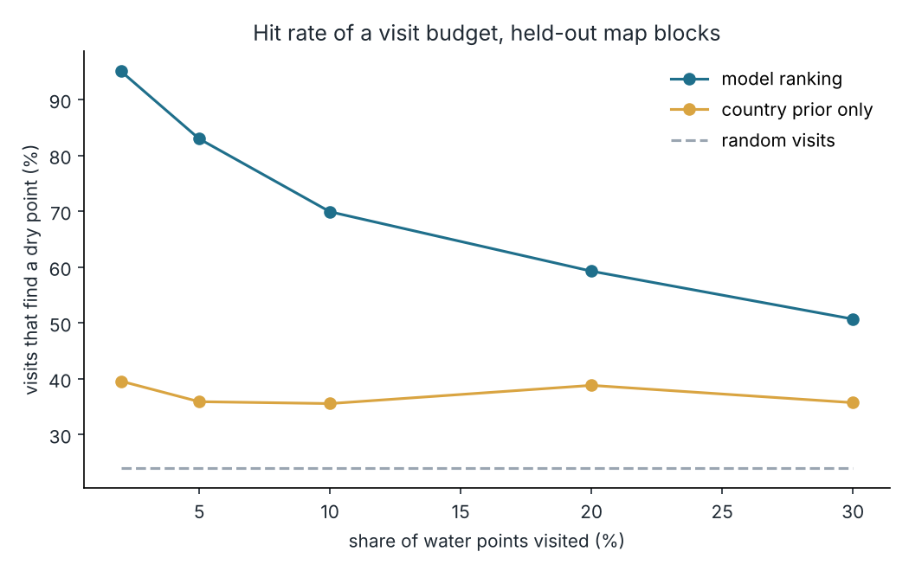
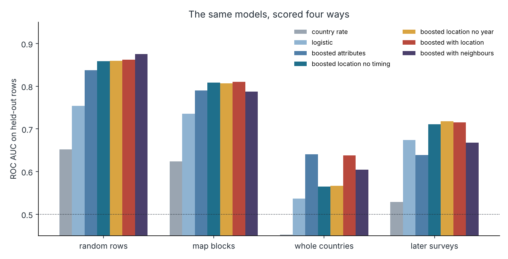
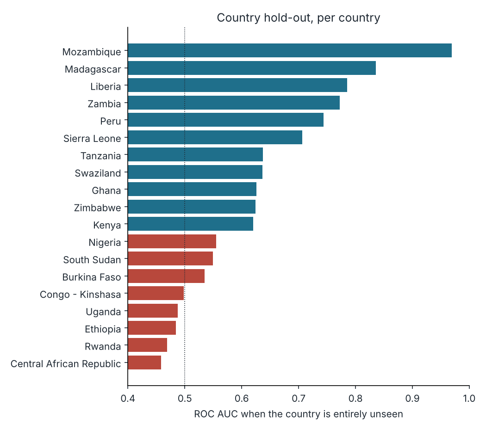
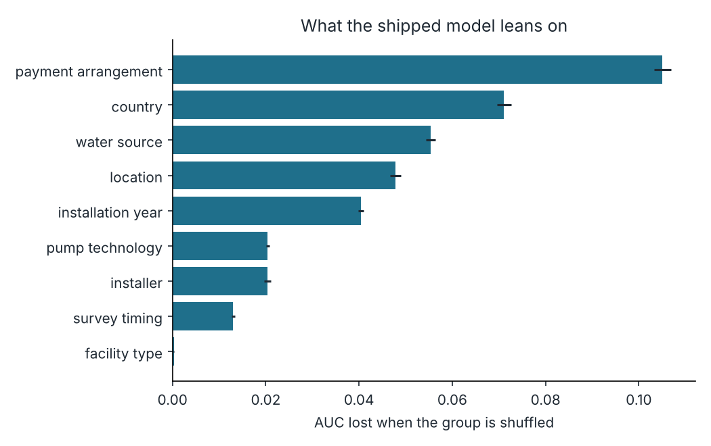
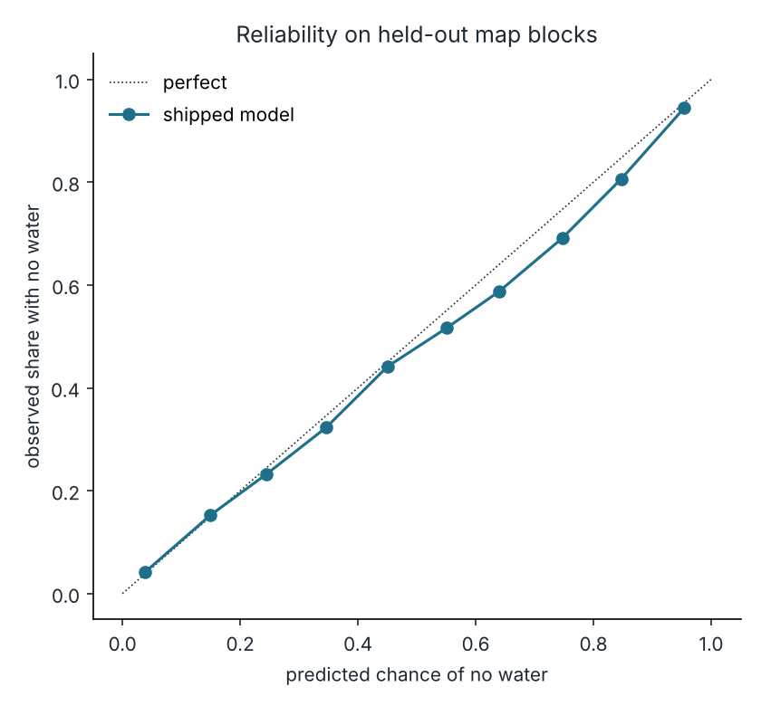
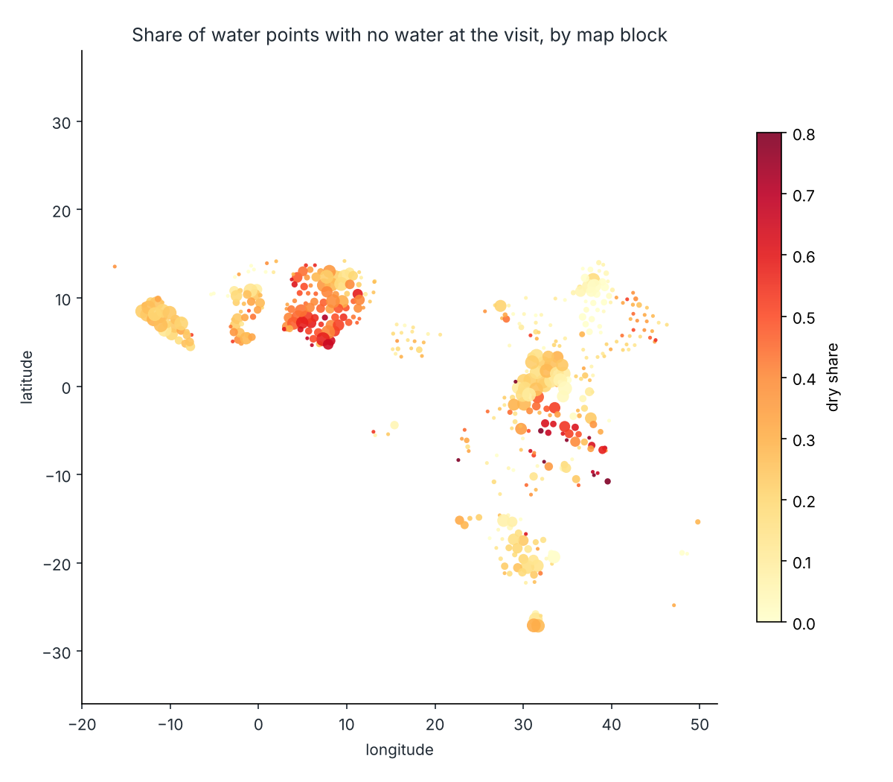

# dryspot

[](https://github.com/ranjithguggilla/dryspot/actions/workflows/ci.yml)

dryspot ranks water points in Africa by the chance that nobody will find water there on the next visit. It is built for a maintenance team that can only visit a fraction of the points on its list and wants those visits to find broken ones.

The data is 438,538 water points from the Water Point Data Exchange, 24.0% of which had no water on the day they were surveyed. The part I spent most time on is validation. A model scored on randomly held-out rows looks much better than the same model scored on parts of the map it has never seen, and the second number is the one a field team lives with.

## Results

Everything below was measured on held-out data and comes from `outputs/metrics.json`. Held-out means whole h3 map blocks (about 60 km across) unless a row says otherwise.

The shipped model gets a ROC AUC of 0.809 on unseen map blocks (95% interval 0.800 to 0.817, resampled by map cell). With a budget of visiting 10% of the list:

| strategy | share of visits that find a dry point | cost per fault found | technician-days per 100 faults |
|---|---|---|---|
| random visits | 24.0% | $146 | 69.6 |
| country average only | 35.5% (33.7 to 37.5) | $98 | 46.9 |
| dryspot ranking | 69.9% (67.6 to 72.5) | $50 | 23.8 |

The gain over the country-average rule is 34.4 points (31.4 to 37.3). Cost assumes $35 per visit and six visits per technician-day, and counts only the visit that confirms the fault, not the repair. Change both in `src/dryspot/config.py`.



### The same models, scored four ways

| model | random rows | map blocks | whole countries | later surveys |
|---|---|---|---|---|
| country average | 0.652 | 0.624 | 0.453 | 0.529 |
| logistic regression | 0.754 | 0.736 | 0.537 | 0.674 |
| boosted, attributes only | 0.837 | 0.790 | 0.641 | 0.639 |
| boosted, location, no survey timing (shipped) | 0.859 | 0.809 | 0.565 | 0.711 |
| boosted, location, no survey year | 0.860 | 0.807 | 0.566 | 0.718 |
| boosted, location and timing | 0.863 | 0.811 | 0.638 | 0.715 |
| boosted, location and neighbour dry rate | 0.876 | 0.788 | 0.605 | 0.668 |

All values are ROC AUC. Three things stand out.

The neighbour feature (the dry share among the ten nearest surveyed points) is the best model on random rows and falls to 0.788 on unseen map blocks, below the plain location model. Random splits put a test point's neighbours in the training set, so the feature looks brilliant there and has nothing to work with in a new area.

The best map-block model is the one with survey timing. I shipped the version without it. Its AUC gap to the best is 0.0016, with a paired interval of -0.0017 to 0.0041, so the two cannot be told apart. Survey year and month partly stand in for which team ran a campaign, and that will not carry over to the next campaign. The selection rule is in `study.choose_model`: the simplest model whose paired gap to the best includes zero.

Coordinates help inside a surveyed region and hurt across borders. When a whole country is held out, the attributes-only model (0.641) beats every model that has latitude and longitude. If you point dryspot at a country that is not in the training data, expect a score near 0.56 to 0.64, which is weak. Median per-country AUC in that setting was 0.624, and it ranged from 0.458 (Central African Republic) to 0.969 (Mozambique).





### Leakage check on the free-text status field

About 82% of rows carry a free-text `status` note written by the surveyor. A TF-IDF logistic regression on that text alone reaches a ROC AUC of 0.991 on held-out map blocks. That is not a prediction, it is the visit report restated, so the column is excluded from every model. It would be the easiest way to publish a score that is useless before anyone has gone out.

### What the model leans on

Shuffling a group of columns together on 40,000 held-out rows and measuring the AUC lost:

| group | AUC lost |
|---|---|
| payment arrangement | 0.105 |
| country | 0.071 |
| water source | 0.055 |
| location | 0.048 |
| installation year | 0.040 |
| pump technology | 0.020 |
| installer | 0.020 |
| survey timing | 0.013 |
| facility type | 0.000 |

Payment arrangement is the strongest signal and I would not read it as cause. Points where users pay are dry 13.2% of the time against 30.4% for free ones (the rest are unclear or unrecorded), but the data cannot say whether fees fund repairs or whether committees form around pumps that already work. Survey timing still shows 0.013 because `age at report` is built from the report year; the model is not given the year or month directly.



### Calibration and uncertainty

The raw boosted probabilities were already well calibrated on held-out blocks (expected calibration error 0.0154, Brier 0.1376). An isotonic step fitted on one half of the blocks and scored on the other half made it slightly worse (0.0231, 0.1381), so the shipped model does not use one.

A Mondrian conformal classifier by country, calibrated on half the blocks and tested on the rest, gave 89.1% coverage at a nominal 90%. 74.1% of points got a single label, and those single-label calls were right 86.2% of the time. The median country covered 88.7%. Two countries fell under 80%: Burkina Faso, and Peru at 40.3%. Peru has 555 points across 12 blocks and a dry rate of 1.3% against 24.0% overall, so its half of the calibration data is small and block-to-block differences probably dominate. I did not dig further.



### Where the dry points are



## Architecture

```
 water.csv (WPDx extract)
        |
        v
 +--------------+     +-------------------+     +------------------------+
 | data.clean   | --> | h3 blocks and     | --> | four hold-out regimes  |
 | label, dedupe|     | cells (validation)|     | random / block / country|
 | coordinates  |     +-------------------+     | / later surveys         |
 +--------------+                               +-----------+------------+
                                                            |
        +---------------------------------------------------+
        v
 +----------------------------+     +--------------------------+
 | 7 candidate pipelines      | --> | selection: simplest model |
 | engineer -> encode -> fit  |     | tied with best (paired    |
 +----------------------------+     | cell bootstrap)           |
                                    +------------+-------------+
                                                 |
          +--------------------+-----------------+------------------+
          v                    v                                    v
   calibration check     conformal sets by country        economics + importance
          \                    |                                    /
           +-------------------+------------------+----------------+
                                                  v
                          model.joblib, metrics.json, charts
                                                  |
                              +-------------------+-----------+
                              v                               v
                    dryspot score (csv)              Gradio app + folium map
```

## Installation

Python 3.11 or newer.

```bash
git clone https://github.com/ranjithguggilla/dryspot.git
cd dryspot
python -m venv .venv && source .venv/bin/activate
pip install -r requirements.txt
pip install -e .
```

## Usage

1. Fetch the data. The csv is 58 MB, so it is not in the repository.

   ```bash
   dryspot download
   ```

2. Train and validate. On a two-core machine the full run took about 25 minutes, almost all of it in the 13 model fits per candidate. Use `--max-rows` for a quick look.

   ```bash
   dryspot train                      # full data, 4 folds, 200 bootstrap resamples
   dryspot train --max-rows 60000 --folds 3 --bootstrap 30
   ```

3. Rank a list of water points. The csv needs `lat_deg`, `lon_deg` and `country_name`; `water_source`, `water_tech`, `facility_type`, `install_year`, `installer` and `pay` improve the score when present.

   ```bash
   dryspot score my_points.csv --out ranked.csv --visit-share 0.1
   ```

4. Open the app, with a single-point checker and a list ranker that draws a map.

   ```bash
   dryspot app
   ```

Without the raw csv, `dryspot train` falls back to the 6,224-row sample in `data/sample.csv.gz`, which is enough for the tests and for a smoke run but not for the numbers above.

## Configuration

Settings live in `src/dryspot/config.py`.

| name | default | meaning |
|---|---|---|
| `BLOCK_RESOLUTION` | 3 | h3 resolution of the held-out map blocks |
| `CELL_RESOLUTION` | 5 | h3 resolution used to group bootstrap resamples |
| `NEIGHBOURS` | 10 | neighbours in the neighbour dry-rate feature |
| `SPLIT_YEAR` | 2015 | train on surveys up to this year, test on later ones |
| `COST_PER_VISIT_USD` | 35 | cost of one confirming visit |
| `VISITS_PER_TECH_DAY` | 6 | visits one technician completes in a day |
| `DEFAULT_VISIT_SHARE` | 0.10 | share of a list marked visit-first |

## Output structure

```
outputs/
  metrics.json               every number quoted in this README
  validation_results.csv     AUC, PR-AUC, Brier, ECE per model and regime
  precision_sweep.csv        hit rate by share of points visited
  country_holdout_auc.csv    AUC per country when the country is unseen
  permutation_importance.csv grouped importance of the shipped model
  oof_predictions.parquet    held-out predictions from the block regime (not committed)
  model.joblib               shipped pipeline plus background sample (not committed)
assets/                      the charts used above
```

## Project structure

```
src/dryspot/
  config.py       paths, constants, cost assumptions
  data.py         download, load, clean, sample
  features.py     stateless feature engineering and the neighbour dry-rate transformer
  validation.py   h3 cells and the four hold-out regimes
  models.py       country-average baseline, logistic regression and boosted pipelines
  evaluate.py     metrics, calibration error, cell-level bootstrap
  uncertainty.py  isotonic check and conformal sets
  economics.py    visit-budget comparison with stated costs
  explain.py      grouped permutation importance and per-point reasons
  study.py        runs everything and writes the outputs
  score.py        scoring used by the cli, the app and the tests
  mapview.py      folium map of a ranked list
  app.py          Gradio app
  cli.py          dryspot command
tests/            pytest suite
data/sample.csv.gz  stratified sample used by tests
```

## Technical details

**Cleaning.** Rows with an unknown status (6.5% of the raw extract) are dropped because there is no label. 1,872 exact duplicates were removed, ignoring the row id. 1,432 points whose coordinates sit at (0, 0) or far outside their country were dropped, using a distance-from-median rule with a 300 km floor. 564 rows with a report year outside 2000 to 2021 were dropped, and 1,733 impossible install years (before 1950 or after the survey) were blanked rather than removing the row. That leaves 438,538 rows in 32 countries.

**Features.** Country, source, technology, a pump-family grouping, facility class, a free/fee/unknown reading of the messy payment text, a normalised installer name, latitude and longitude, install year, age at report, and a flag for missing install year. Categorical values rarer than 200 rows are pooled by the encoder inside the pipeline, so nothing is learned from the full data before a split.

**Models.** The boosted models are scikit-learn `HistGradientBoostingClassifier` with native categorical handling, early stopping on a 10% internal split, and 250 iterations at most. The neighbour feature is a k-d tree on unit-sphere coordinates; during fitting each training row is scored from its neighbours with itself removed.

**Validation.** Four regimes: stratified random folds, whole h3 blocks, whole countries, and a forward split (train on report years up to 2015, test on 2016 and later). Bootstrap intervals resample map cells rather than rows because points in one cell are not independent. Model choice uses a paired cell-level bootstrap on the block regime.

**Reasons for a single score.** For each group of inputs the point's values are swapped for values drawn from real water points and the predicted risk is averaged. The difference is reported in points of risk. Swaps can create unlikely combinations, so these are guides to what drives a score, not causes.

**Limits.** The label is a single snapshot: dry on the day of the visit, which includes seasonal dry spells and not only broken pumps. Surveys are not a random sample of water points. Predictions for a country absent from training are weak (see above). The cost figures are assumptions and exclude repair.

## Testing

```bash
pip install -r requirements-dev.txt
ruff check .
pytest --cov=dryspot
```

The suite has tests for cleaning rules, feature functions, the neighbour transformer (including that a row never sees itself), each hold-out regime, metric and bootstrap behaviour, calibration and conformal coverage on synthetic data, the economics arithmetic, scoring and ranking, the app functions, the command line, and an end-to-end study on the sample that checks every output file is written. Ruff and pytest both pass locally.

## Dataset credit

Water Point Data Exchange (WPDx) basic extract, as redistributed by the TidyTuesday project: https://github.com/rfordatascience/tidytuesday/tree/main/data/2021/2021-05-04. Original source: https://data.waterpointdata.org/dataset/Water-Point-Data-Exchange-WPDx-Basic-/jfkt-jmqa. The extract is limited to core columns and largely to African sources.

## License

MIT, see [LICENSE](LICENSE).
